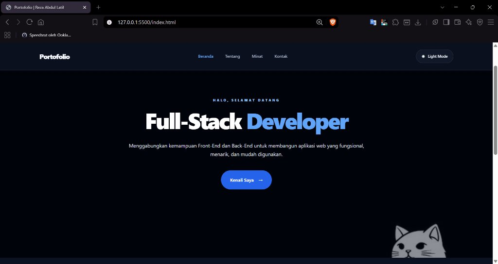
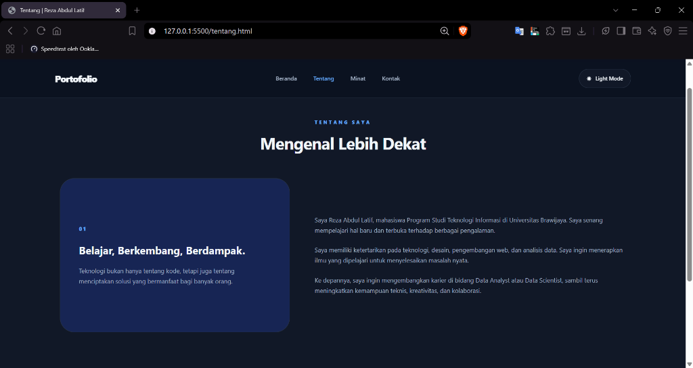
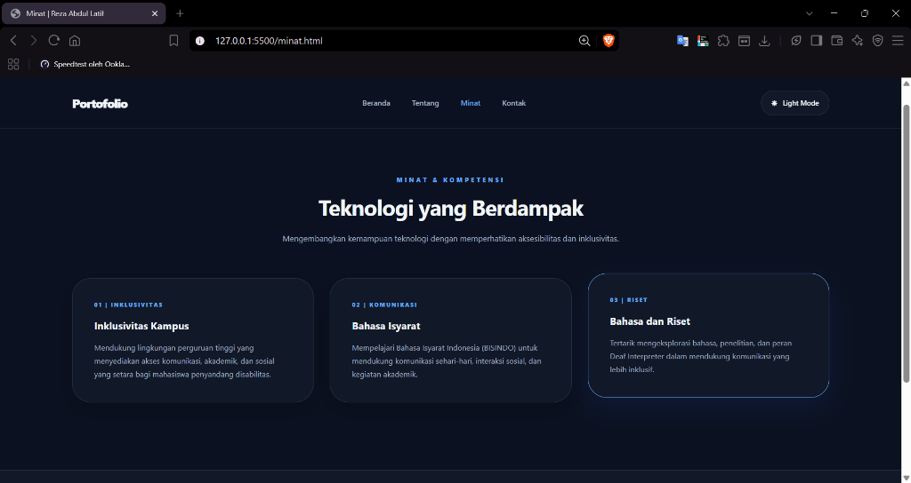
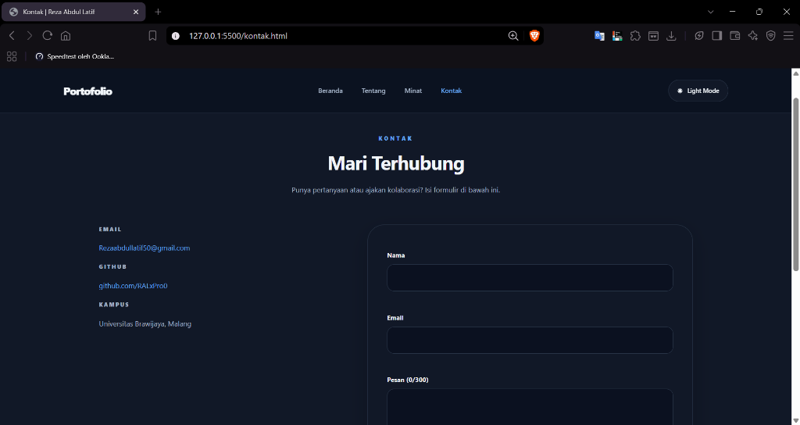

# Portofolio Web Personal - Reza Abdul Latif

Website portofolio multi-halaman dengan HTML5, CSS3, dan JavaScript murni, tanpa framework atau library.

## Halaman
| File | Isi |
| :--- | :--- |
| `index.html` | Beranda (hero dan pintasan ke halaman lain) |
| `tentang.html` | Tentang saya |
| `minat.html` | Minat dan kompetensi |
| `kontak.html` | Kontak dan formulir pesan |

## Fitur interaktif (JavaScript Event)
1. Mode gelap/terang, tersimpan di localStorage (`click`)
2. Menu hamburger responsif, tutup dengan Escape (`click`, `keydown`, `resize`)
3. Jam digital real-time dan tahun otomatis (`setInterval`)
4. Tombol kembali ke atas (`scroll`, `click`)
5. Formulir kontak dengan validasi dan penghitung karakter (`submit`, `input`)

## Tampilan Website (Screenshot)

### 1. Halaman Beranda (`index.html`)


### 2. Halaman Tentang (`tentang.html`)


### 3. Halaman Minat & Kompetensi (`minat.html`)


### 4. Halaman Kontak (`kontak.html`)


## Struktur
```
PORTOFOILO-RAL/
├── assets/
│   ├── catimut.jpg
│   ├── ss-beranda.jpg
│   ├── ss-tentang.png
│   ├── ss-minat.png
│   └── ss-kontak.png
├── index.html
├── tentang.html
├── minat.html
├── kontak.html
├── style.css
├── script.js
└── README.md
```

## Menjalankan
Buka `index.html` di browser, atau pakai ekstensi Live Server di VS Code.
